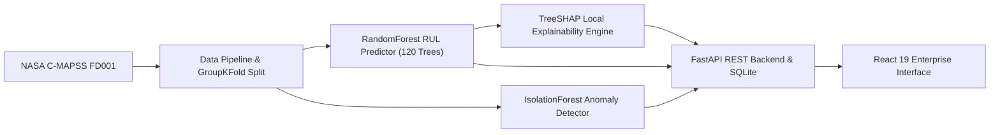

# AeroGuard AI: Turbofan Engine Predictive Maintenance Platform

[](https://python.org)
[](https://fastapi.tiangolo.com)
[](https://react.dev)
[](https://vite.dev)
[](https://tailwindcss.com)
[](https://data.nasa.gov)

AeroGuard AI is an enterprise-grade, leak-free machine-learning aviation reliability platform designed to estimate Remaining Useful Life (RUL) and detect sensor anomalies in commercial turbofan aircraft engines based on the NASA C-MAPSS FD001 dataset.

> **DEMO & RESEARCH PROTOTYPE DISCLAIMER:**
> This software is an experimental decision-support prototype. Outputs do **NOT** certify aircraft airworthiness, diagnose real-world flight hardware, or autonomously authorize maintenance actions without certified human engineering approval according to applicable maintenance manuals.

---

## Architecture Overview



- **Supervised Prognostics:** Scikit-learn `RandomForestRegressor` (120 estimators) trained with engine-wise `GroupKFold` cross-validation (strict zero-leakage guarantee across engine units).
- **Unsupervised Anomaly Surveillance:** `IsolationForest` trained on 3,000 nominal early cycles across strictly physical sensors (excluding cycle, engine ID, and RUL to eliminate age bias).
- **Model Explainability:** Exact game-theoretic `TreeSHAP` local feature attributions and global Gini feature importance rankings.
- **Workflow & Persistence:** FastAPI REST API with SQLite database supporting audit logging and persistent maintenance triage alerts (`OPEN` -> `ACKNOWLEDGED` -> `RESOLVED`).
- **Enterprise Design System:** GitHub/Linear-inspired neutral theme supporting persistent light/dark modes and English/Hindi language selection, with accessible typography, compact tables, and responsive cards.

---

## Model Benchmark Performance (NASA C-MAPSS FD001)

| Split / Benchmark | Metric | Result |
|:---|:---|:---:|
| **5-Fold GroupKFold (Cross-Validation)** | Mean MAE | **11.45 ± 0.61 cycles** |
| | Mean RMSE | **16.76 ± 0.72 cycles** |
| | Mean $R^2$ | **0.838** |
| **Official NASA Test Set (100 Engines)** | Test MAE | **12.53 cycles** |
| | Test RMSE | **16.94 cycles** |
| | Test $R^2$ | **0.821** |
| | NASA Asymmetric Penalty | **500.0** |

---

## Quick Start Guide

### Prerequisites
- Python 3.11+ (verified up to Python 3.14)
- Node.js 18+ (verified on Node 24 LTS)
- Git

### 1. Setup Environment
```bash
# Clone the repository
git clone https://github.com/ankitnapit24/Nex-Aero.git
cd Nex-Aero

# Create Python virtual environment
python -m venv .venv

# Windows PowerShell:
.\.venv\Scripts\Activate.ps1
# macOS/Linux:
source .venv/bin/activate

# Install backend dependencies
pip install -r requirements.txt
```

### 2. Download Dataset & Train Models
```bash
# 1. Download NASA C-MAPSS FD001 data files into data/raw/
python scripts/download_dataset.py

# 2. Preprocess data and generate ground-truth labels
python scripts/prepare_dataset.py

# 3. Train leak-free RandomForest pipeline & evaluate on test fleet
python scripts/train_model.py

# 4. Train unsupervised Isolation Forest anomaly detector
python scripts/train_anomaly_detector.py
```

### 3. Run Automated Tests
```bash
pytest tests/ -v
```

### 4. Start the Application

#### Start Backend (Terminal 1)
```bash
# Windows PowerShell:
$env:PYTHONPATH = "$PWD"
.\.venv\Scripts\uvicorn backend.app.main:app --host 127.0.0.1 --port 8000 --reload

# macOS/Linux:
export PYTHONPATH="$PWD"
uvicorn backend.app.main:app --host 127.0.0.1 --port 8000 --reload
```
Interactive Swagger API documentation: [http://localhost:8000/docs](http://localhost:8000/docs)

#### Start Frontend (Terminal 2)
```bash
cd frontend
npm install
npm run dev
```
Open your browser to: [http://localhost:5173](http://localhost:5173)

---

## Demo Walkthrough

1. **Fleet Health Overview (`/`):**
   - View all 100 test turbofan engines prioritized by urgency (lowest RUL first).
   - Filter by urgency tier (Critical: RUL ≤ 25c, Warning: 25-50c, Moderate: 50-80c, Nominal: >80c).
   - Verify NASA ground truth comparisons (`ENG-034` predicted 7.1 cycles vs NASA ground truth 7.0 cycles).

2. **Sensor Telemetry & Historical Degradation Replay (`/engines/34`):**
   - Inspect historical multi-channel degradation trends (LPC/HPC/LPT temperatures, HPC pressure, rotor speeds).
   - Use simulated historical playback player with play/pause/scrub controls to inspect step-by-step wear evolution.

3. **Real-Time ML Inference Simulator (`/predictions`):**
   - Select an engine to populate authentic sensor readings.
   - Run inference to get instant RUL estimation and anomaly classification.
   - Click **Calculate Local TreeSHAP Attributions** to view exact feature contribution bars.

4. **Unsupervised Anomaly Surveillance (`/anomalies`):**
   - Inspect fleet-wide Isolation Forest anomaly scores evaluated strictly on physical parameters.
   - Filter by anomalous units and drill down to inspect sensor drifts.

5. **Maintenance Triage & Review Queue (`/maintenance`):**
   - Review persistent SQLite maintenance alerts.
   - Transition alert status between Open, Acknowledged, and Resolved with persistent state.
   - Review draft work orders with review-oriented advisory protocols.

6. **Model Transparency & SHAP Analytics (`/analytics`):**
   - Inspect global Gini feature weights, zero-leakage cross-validation methodology, and interactive TreeSHAP explainability inspector.

---

## License & Attribution
- NASA C-MAPSS dataset provided by NASA Ames Research Center Prognostics Center of Excellence (PCoE).
- Developed for demonstration and research purposes under the AeroGuard AI initiative.
