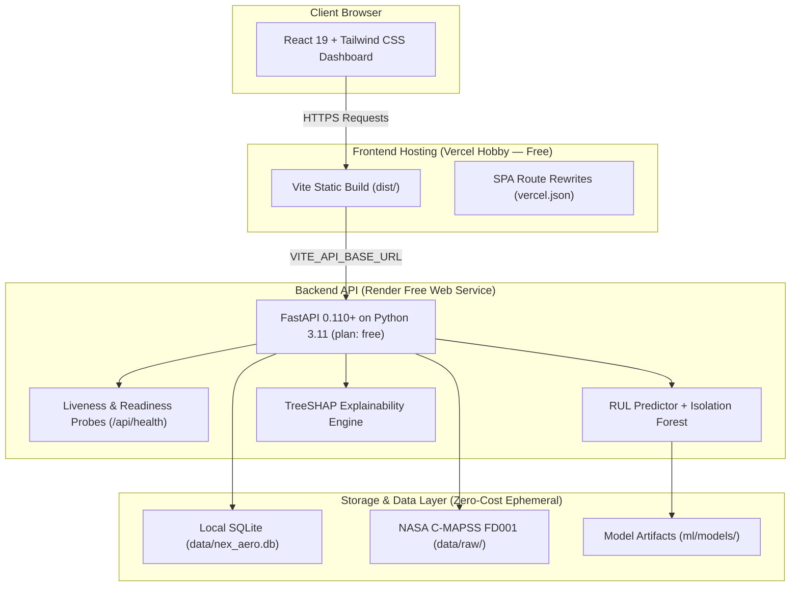

# Nex Aero: Turbofan Engine Predictive Maintenance Platform

[](https://python.org)
[](https://fastapi.tiangolo.com)
[](https://react.dev)
[](https://vite.dev)
[](https://tailwindcss.com)
[](https://data.nasa.gov)
[](https://render.com)
[](https://vercel.com)

Nex Aero is an enterprise-grade, leak-free machine-learning aviation reliability platform designed to estimate Remaining Useful Life (RUL) and detect sensor anomalies in commercial turbofan aircraft engines based on the NASA C-MAPSS FD001 dataset.

> **DEMO & RESEARCH PROTOTYPE DISCLAIMER:**  
> This software is an experimental decision-support prototype. Outputs do **NOT** certify aircraft airworthiness, diagnose real-world flight hardware, or autonomously authorize maintenance actions without certified human engineering approval according to applicable maintenance manuals.

---

## 100% Free-Tier Cloud Deployment Architecture



For complete documentation:
- [Free-Tier Deployment Guide](docs/deployment-guide.md)
- [Free-Tier Infrastructure & Limitations](docs/free-tier-limitations.md)
- [Pre-Deployment Audit Matrix](docs/free-deployment-audit.md)

---

## Key Capabilities

- **Supervised Prognostics:** Scikit-learn `RandomForestRegressor` (100 estimators) trained with engine-wise `GroupKFold` cross-validation (strict zero-leakage guarantee across engine units).
- **Unsupervised Anomaly Surveillance:** `IsolationForest` trained on nominal early cycles across strictly physical sensors (excluding cycle, engine ID, and RUL to eliminate age bias).
- **Local & Global Explainability:** Exact game-theoretic `TreeSHAP` local feature attributions and global Gini feature importance rankings.
- **Workflow & Persistence:** FastAPI REST API with SQLite database supporting audit logging and maintenance triage alerts (`OPEN` -> `ACKNOWLEDGED` -> `RESOLVED`).
- **Enterprise Design System:** GitHub/Linear-inspired neutral theme supporting persistent light/dark modes and English/Hindi language selection, with accessible typography, compact tables, and responsive cards.

---

## Model Benchmark Performance (NASA C-MAPSS FD001)

| Split / Benchmark | Metric | Result |
|:---|:---|:---:|
| **5-Fold GroupKFold (Cross-Validation)** | Mean MAE | **11.45 ± 0.61 cycles** |
| | Mean RMSE | **16.76 ± 0.72 cycles** |
| | Mean $R^2$ | **0.838** |
| **Official NASA Test Set (100 Engines)** | Test MAE | **12.53 cycles** |
| | Test RMSE | **16.94 cycles** |
| | Test $R^2$ | **0.821** |
| | NASA Asymmetric Penalty | **500.0** |

---

## Local Development Quickstart

### Prerequisites
- Python 3.11+ (verified up to Python 3.14)
- Node.js 18+ (verified on Node 24 LTS)
- Git

### 1. Setup Backend
```bash
# Clone the repository
git clone https://github.com/ankitnapit24/Nex-Aero.git
cd Nex-Aero

# Create Python virtual environment
python -m venv .venv

# Windows PowerShell:
.\.venv\Scripts\Activate.ps1
# macOS/Linux:
source .venv/bin/activate

# Install backend dependencies
pip install --upgrade pip
pip install -r requirements.txt

# Automated deployment preparation (downloads NASA dataset, trains models, validates artifacts)
python scripts/prepare_deployment.py

# Start local FastAPI server
python -m uvicorn backend.app.main:app --host 127.0.0.1 --port 8000 --reload
```
Interactive Swagger API documentation: [http://localhost:8000/docs](http://localhost:8000/docs)

### 2. Setup Frontend
```bash
# In a new terminal window:
cd frontend
npm install
npm run dev
```
Open your browser to: [http://localhost:5173](http://localhost:5173)

### 3. Run Automated Tests
```bash
# Backend unit & integration tests
pytest tests/ -v

# End-to-end smoke test suite (against deployed backend or local)
python scripts/deployment_smoke_test.py --url http://127.0.0.1:8000
```

---

## 100% Free Cloud Deployment (Zero Payment / No Credit Card)

### 1. Deploy Backend on Render Free
1. Go to [dashboard.render.com](https://dashboard.render.com/) and click **New +** -> **Blueprint**.
2. Select your repository `ankitnapit24/Nex-Aero`.
3. Render auto-reads `render.yaml` with **Plan: Free** and **Zero Paid Disks**.
4. Click **Apply**.
5. Wait for the build to complete and copy your public service URL (`https://nex-aero-api.onrender.com`).

### 2. Deploy Frontend on Vercel Hobby (Free)
1. Go to [vercel.com](https://vercel.com/) and click **Add New...** -> **Project**.
2. Import repository `ankitnapit24/Nex-Aero`.
3. Set **Root Directory** to `frontend`.
4. Add Environment Variable:
   - `VITE_API_BASE_URL`: `https://nex-aero-api.onrender.com`
   - `VITE_API_TIMEOUT_MS`: `45000`
5. Click **Deploy**.

### 3. Link CORS
In Render Dashboard -> `nex-aero-api` -> **Environment**, update `CORS_ORIGINS`:
```env
CORS_ORIGINS=https://your-app.vercel.app,http://localhost:5173
```

---

## Project Structure

```
Nex-Aero/
├── .github/
│   └── workflows/
│       └── ci.yml               # Automated CI test & build workflow
├── backend/
│   ├── app/
│   │   ├── api/routes/          # health, engine, prediction, alert routes
│   │   ├── core/config.py       # Pydantic environment settings & CORS validator
│   │   ├── database/            # SQLAlchemy session & SQLite models
│   │   ├── schemas/             # Pydantic schemas for requests/responses
│   │   ├── services/            # EngineService telemetry catalog
│   │   └── main.py              # FastAPI app & lifespan handlers
│   ├── .env.example
│   └── requirements.txt
├── frontend/
│   ├── src/                     # React components, pages, services, design tokens
│   ├── package.json
│   ├── vite.config.js
│   ├── vercel.json              # SPA route rewrites for Vercel
│   └── .env.example
├── ml/
│   ├── config.py                # Sensor definitions & feature lists
│   ├── data_processing/         # C-MAPSS dataset loaders & RUL calculators
│   ├── inference/               # RULPredictor & SHAPExplainer
│   └── models/                  # Joblib pipelines & JSON metadata
├── data/
│   ├── raw/                     # NASA C-MAPSS FD001 text files
│   └── processed/               # Clean tabular CSV artifacts
├── scripts/
│   ├── download_dataset.py      # Automated dataset downloader & validator
│   ├── prepare_dataset.py       # Tabular preprocessing & RUL capping
│   ├── train_model.py           # Leak-free Random Forest training pipeline
│   ├── train_anomaly_detector.py # Isolation Forest sensor anomaly training
│   ├── prepare_deployment.py    # Master idempotent cloud build orchestrator
│   └── deployment_smoke_test.py # Live cloud deployment verification suite
├── tests/                       # Pytest test suite (20 test cases)
├── docs/
│   ├── free-deployment-audit.md # Free-tier conversion audit & paid removal
│   ├── free-tier-limitations.md # Free-tier cloud infrastructure limitations
│   └── deployment-guide.md      # Step-by-step free-tier deployment guide
├── render.yaml                  # Render Free Blueprint (plan: free, no paid disks)
├── vercel.json                  # Root Vercel SPA configuration
├── requirements.txt             # Root Python dependencies
└── README.md
```

---

## License & Attribution
- NASA C-MAPSS dataset provided by NASA Ames Research Center Prognostics Center of Excellence (PCoE).
- Developed for demonstration and research purposes under the Nex Aero initiative.
