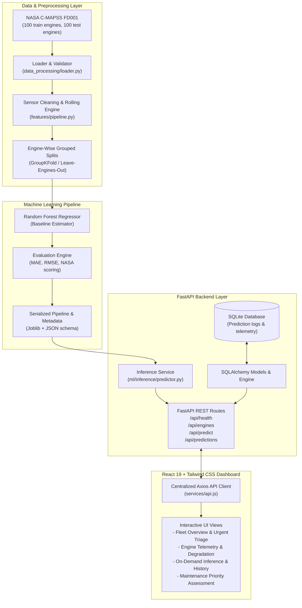

# Nex Aero - System Architecture

Nex Aero is an end-to-end predictive-maintenance decision-support prototype for aircraft turbofan engines, trained on the NASA C-MAPSS dataset.

## System Overview

## Key Architectural Principles

1. **Strict Data Leakage Prevention:**
   - Preprocessing transforms and scalers are fitted solely on training engines.
   - Validation splits are grouped strictly by unit ID (`GroupKFold` / `GroupShuffleSplit`). Rows from an individual engine never span train and test sets.
   - Test labels (`RUL_FD001.txt`) are reserved exclusively for terminal cycle evaluation and never used during training, feature selection, or tuning.

2. **Aviation Safety & Responsible AI Framing:**
   - Nex Aero outputs are non-authoritative research estimates for maintenance planning triage.
   - Outputs are explicitly disclaimed as decision-support heuristics; they do not certify aircraft airworthiness.
   - Negative predicted values are bounded to zero only as a presentation guard, with raw model output logged.

3. **Modularity & Extensibility:**
   - Clean decoupling between data parsing, ML training, inference serving, database storage, and presentation.
   - Configurable urgency thresholds:
     - **Critical Assessment:** Estimated RUL $\le 25$ operating cycles.
     - **Warning Assessment:** $25 < \text{RUL} \le 50$ operating cycles.
     - **Moderate Monitoring:** $50 < \text{RUL} \le 80$ operating cycles.
     - **Nominal Condition:** $\text{RUL} > 80$ operating cycles.
